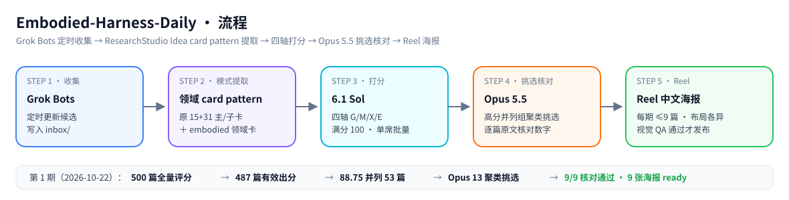
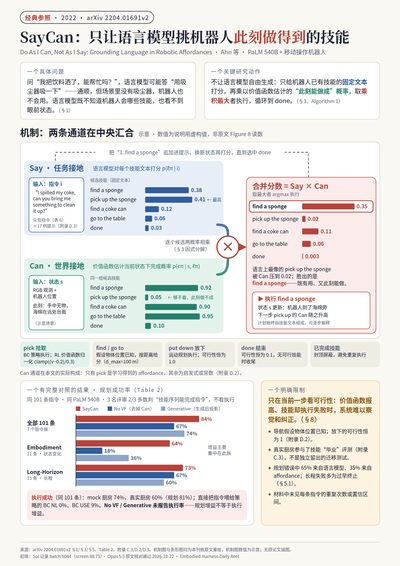
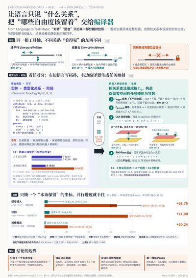
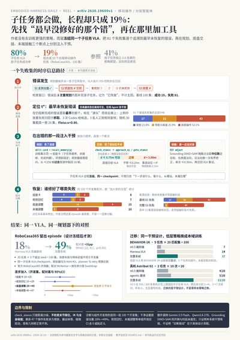
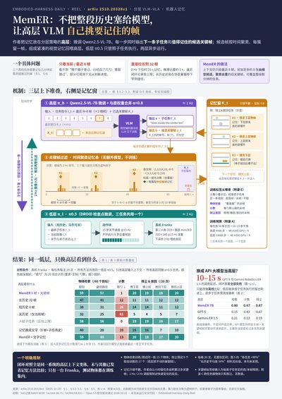
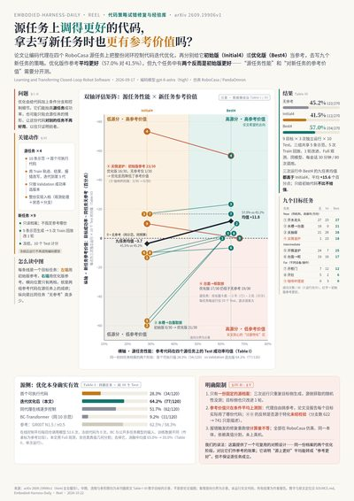
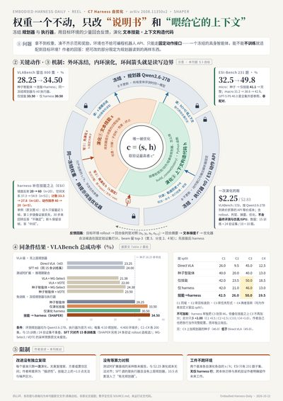
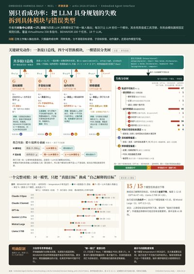
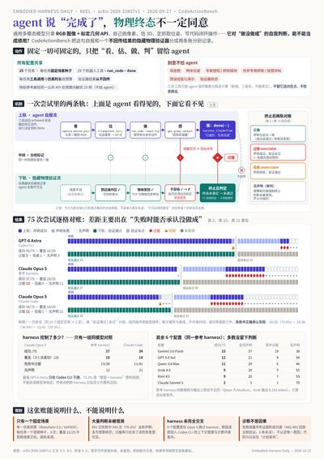

# Embodied-Harness-Daily（原 EH Radar — Embodied Harness）

`domain: embodied agent harness` · `scoring: sol-batch-v3` · `reel: 2026-10-22 第 1 期` · `license: MIT`



追踪前沿 LLM/VLM 或 coding agent 如何借助 harness 控制具身系统，覆盖机械臂、移动操作、导航、无人机和人形机器人。harness 由工具、冻结 VLA/技能、感知原语、记忆、验证和执行控制组成；也收录 harness 教师轨迹蒸馏、on-policy 纠正、harness 内 RL、自我优化及其评测。无 harness/教师闭环的纯 VLA、GUI agent 和非具身 RSI 不在范围内。

核心问题：**模型通过哪一层 harness 控制什么本体？闭环成败如何判定？改进来自 harness、策略，还是额外预算/特权信息？**

## 从这里开始

| 内容 | 入口与状态 |
|---|---|
| 本期 Reel | [reel/README.md](reel/README.md)：9 篇核对通过的海报索引，每篇布局各异 |
| 评分记录 | [final/index.jsonl](research/v3/runs/embodied-v3-20261021-01/final/index.jsonl)：500 篇逐篇 JSONL |
| 选择过程 | [final/selection.md](research/v3/runs/embodied-v3-20261021-01/final/selection.md)＋[reel/selection-opus.md](reel/selection-opus.md) |
| 评分规则 | [SCORE_SPEC](research/v3/docs/SCORE_SPEC.md)（`sol-batch-v3` · [embodied profile](research/v3/docs/embodied.md)）；run 记录见 [run.md](research/v3/runs/embodied-v3-20261021-01/run.md) |
| 高分表数据 | [top30.tsv](research/v3/runs/embodied-v3-20261021-01/top30.tsv) ＋[code_links.tsv](research/v3/runs/embodied-v3-20261021-01/code_links.tsv) |
| 流程文档 | [PIPELINE](docs/PIPELINE.md)；[维护规则](docs/MAINTAINING.md)；[收录范围](docs/EVIDENCE.md)；[设计依据](docs/DESIGN_BASIS.md) |
| 模式卡 | [overview](patterns/overview.md)（embodied 领域 17 主卡/58 子卡）；[原 15+31 冻结副本](research/reference/researchstudio-15-31/) |
| Grok 收集 | [GROK_PROMPT](docs/agents/GROK_PROMPT.md)：只收有一手证据的候选，定时更新写 inbox/ |

## 高分速览（2026 年论文 · 前 30 篇 · 满分 100）

按初筛分排序、**仅展示 2026 年（26xx）论文**。paper 号链到海报的 6 篇即本期 Reel 的 2026 年部分（含中文海报）；另 3 篇 Reel（[2204.01691](reel/2204.01691/poster.png) SayCan 2022 经典参照、[2510.20328](reel/2510.20328/poster.png) 2025、[2410.07166](reel/2410.07166/poster.png) 2024）不属 2026，见下方海报墙。完整 500 篇分数见 [index.jsonl](research/v3/runs/embodied-v3-20261021-01/final/index.jsonl)；表格数据 [top30.tsv](research/v3/runs/embodied-v3-20261021-01/top30.tsv) ＋[code_links.tsv](research/v3/runs/embodied-v3-20261021-01/code_links.tsv)。

| paper | 分 | G/M/X/E | 标题 | 机制一句话 | 链接 |
|---|---:|:-:|---|---|---|
| [2609.34412](reel/2609.34412/poster.png) | 88.8 | 4/4/4/3 | From Language to Task Maps: Compiling Semantic Relations While Preserving T… | LLM只写实体、关系和阶段，编译器查注册关系生成保留零空间的CGA任务映射及导数，再经R… | [arXiv](https://arxiv.org/abs/2609.34412) · code — |
| [2610.19600](reel/2610.19600/poster.png) | 88.8 | 4/4/4/3 | Cracking Mobile Manipulation: From Failure Diagnosis to Agentic Robot System | 先按最早未恢复错误诊断长程失败，再围绕固定VLA增加示范技能卡、按需视觉回忆、可达距离检… | [arXiv](https://arxiv.org/abs/2610.19600) · [code](https://github.com/PKU-VaLuE-Lab/Cracking-Mobile-Manipulation) |
| [2606.10577](reel/2606.10577/poster.png) | 88.8 | 4/4/4/3 | AgenticNav: Zero-Shot Vision-and-Language Navigation as a Tool-Calling Harness | 将像素目标移动、按需深度查询和历史图像召回暴露为工具，配合六步文本历史、BEV和几何拒绝… | [arXiv](https://arxiv.org/abs/2606.10577) · code — |
| [2609.19906](reel/2609.19906/poster.png) | 88.8 | 4/4/4/3 | Learning and Transferring Closed-Loop Robot Software | 编码代理用仿真轨迹改进完整闭环程序，按验证集选入档案，再作为新任务代码生成和修订的参考。 | [arXiv](https://arxiv.org/abs/2609.19906) · code — |
| [2608.11350](reel/2608.11350/poster.png) | 88.8 | 4/4/4/3 | Self-Evolving Embodied Agents via Skill-Harness Evolution | 冻结规划器与执行器，以回合诊断先演化文本技能，再沙箱验证并搜索上下文构造代码。 | [arXiv](https://arxiv.org/abs/2608.11350) · code — |
| [2609.33807](reel/2609.33807/poster.png) | 88.8 | 4/4/4/3 | CodeActionBench: Evaluating Agentic Code-as-Policy for Embodied Manipulation | 固定RGB几何API、任务实例与双预算，将隐藏物理验证与智能体完成声明分离并记录代码执行… | [arXiv](https://arxiv.org/abs/2609.33807) · code — |
| [2602.15875](https://arxiv.org/abs/2602.15875) | 88.8 | 4/4/4/3 | Fly0: Persistent Metric Anchoring for Zero-Shot Aerial Vision-Language Navi… | 将VLM区域与关系输出转成经不确定性门控的持久三维锚点，由机载几何规划器持续跟踪。 | [arXiv](https://arxiv.org/abs/2602.15875) · [code](https://github.com/xuzhenxing1/Fly0) |
| [2610.12549](https://arxiv.org/abs/2610.12549) | 88.8 | 4/4/4/3 | Fly-by-Code: Embodied Coding Agents for Aerial Manipulation with Active Vis… | 每次任务执行后另写诊断程序主动换视角或物理探测，收集新证据后判断完成或修订任务代码。 | [arXiv](https://arxiv.org/abs/2610.12549) · code — |
| [2609.38178](https://arxiv.org/abs/2609.38178) | 88.8 | 4/4/4/3 | Skill-Space Shooting for Autonomous Robot Policy Improvement | 失败值模型触发VLM选择短技能修复，完成任务后仅保留被接受的技能修复段聚合训练任务策略，… | [arXiv](https://arxiv.org/abs/2609.38178) · code — |
| [2607.13049](https://arxiv.org/abs/2607.13049) | 88.8 | 4/4/4/3 | SPINE: Bridging the Cyber-Physical Gap with Agentic AI | 先编译经人工确认的机器人profile，再协调只读诊断、软件修复或人类物理干预，最终以同… | [arXiv](https://arxiv.org/abs/2607.13049) · code — |
| [2607.06256](https://arxiv.org/abs/2607.06256) | 88.8 | 4/4/4/3 | Diagnosing Semantic Handoff Failures in Agent-Orchestrated Vision-Language-… | 以相同VLA检查点对比干净技能快照与串联终态，并用契约和多视角验证追踪交接失败。 | [arXiv](https://arxiv.org/abs/2607.06256) · code — |
| [2604.25788](https://arxiv.org/abs/2604.25788) | 88.8 | 4/4/4/3 | KinDER: A Physical Reasoning Benchmark for Robot Learning and Planning | 构建分离感知语言因素的程序化物理推理环境、技能接口和跨规划学习范式评测。 | [arXiv](https://arxiv.org/abs/2604.25788) · code — |
| [2610.10388](https://arxiv.org/abs/2610.10388) | 88.8 | 4/4/4/3 | RoboQuest: Generalist Physical Agents that Search, Inspect and Test | 构造需搜索、翻看和试验的十类移动操作任务，以物理提交冻结计分，并按未满足目标追溯证据和执… | [arXiv](https://arxiv.org/abs/2610.10388) · code — |
| [2609.21650](https://arxiv.org/abs/2609.21650) | 88.8 | 4/4/4/3 | SynthDemo-RL: Breaking the Zero-Reward Barrier in VLA Adaptation with LLM-G… | LLM修订特权状态教师的轨迹生成程序，成功过滤后SFT视觉学生，再用二元成功PPO补足性能。 | [arXiv](https://arxiv.org/abs/2609.21650) · code — |
| [2603.22435](https://arxiv.org/abs/2603.22435) | 88.8 | 4/4/4/3 | CaP-X: A Framework for Benchmarking and Improving Coding Agents for Robot M… | 建立分层API与反馈的代码机器人评测，再以视觉差分、复用库和候选集成改进agent，并用… | [arXiv](https://arxiv.org/abs/2603.22435) · code — |
| [2607.00272](https://arxiv.org/abs/2607.00272) | 88.8 | 4/4/4/3 | ASPIRE: Agentic /Skills Discovery for Robotics | 编码代理读取逐原语多模态轨迹修复程序，将验证过的修复压成技能，再用演化搜索选择候选程序。 | [arXiv](https://arxiv.org/abs/2607.00272) · code — |
| [2607.12220](https://arxiv.org/abs/2607.12220) | 88.8 | 4/4/4/3 | Contract-Grounded Behavior Tree Synthesis via Coding Agents | coding agent先查询机器人技能、类型、BT算子与模板契约，再提交行为树，由运行… | [arXiv](https://arxiv.org/abs/2607.12220) · [code](https://jsalfity.github.io/agentic-bt-gen-webviewer/) |
| [2608.17386](https://arxiv.org/abs/2608.17386) | 88.8 | 4/4/4/3 | MANIGUARD: A Benchmark and Data Suite for Specification-Grounded Safety Eva… | 构建安全与完成正交的任务、固定规范的单轴扰动，用物理谓词和时序自动机标注执行及安全演示。 | [arXiv](https://arxiv.org/abs/2608.17386) · code — |
| [2608.22657](https://arxiv.org/abs/2608.22657) | 88.8 | 4/4/4/3 | Physical Agentic AI: An Architecture for Orchestrating a Robot Crew with LLMs | 将LLM限定为非执行规划器，由独占执行权的确定性编排器逐步校验技能、请求一致性、工作流和… | [arXiv](https://arxiv.org/abs/2608.22657) · code — |
| [2608.29537](https://arxiv.org/abs/2608.29537) | 88.8 | 4/4/4/3 | AGM: Achievement-Grounded Memory for Closed-Loop Agents with Frozen VLA Pol… | 用夹爪事件触发抓取跟踪和放置验证，仅据验证结果推进、保留或回退子目标指针。 | [arXiv](https://arxiv.org/abs/2608.29537) · code — |
| [2608.30396](https://arxiv.org/abs/2608.30396) | 88.8 | 4/4/4/3 | Scaffolding Foundation Models into Physical-World Agents Pushes the Frontie… | 以语义导航意图、带帧来源的沿途摘要和跨调用证据账本连接冻结VLM与导航模型。 | [arXiv](https://arxiv.org/abs/2608.30396) · code — |
| [2609.12285](https://arxiv.org/abs/2609.12285) | 88.8 | 4/4/4/3 | AnchorVLN: Geometry-Anchored Vision-Language Grounding Reasoning for Open-V… | 用只接受短语和对象句柄的工具边界隔离VLM语义决策与LiDAR度量，并预测不可修改控制器… | [arXiv](https://arxiv.org/abs/2609.12285) · code — |
| [2609.19554](https://arxiv.org/abs/2609.19554) | 88.8 | 4/4/4/3 | VABench: Measuring Embodied Spatial Intelligence through Visual Demonstrati… | 让冻结MLLM从RGB示范推导流程，自选视角并输出数值动作，由共享IK执行器落地并返回反馈。 | [arXiv](https://arxiv.org/abs/2609.19554) · code — |
| [2609.22966](https://arxiv.org/abs/2609.22966) | 88.8 | 4/4/4/3 | Transferring the Intelligence of VLMs to Robotic Control | 为冻结VLM提供以指尖中点为基准的离散运动命令、网格观测和接口兼容示范，执行后返回实际反馈。 | [arXiv](https://arxiv.org/abs/2609.22966) · code — |
| [2609.23841](https://arxiv.org/abs/2609.23841) | 88.8 | 4/4/4/3 | Structured World-State Reasoning for Agentic Robotic Search | 用感知独占写入的持久图承载候选，多个推理器提出查证问题，共享观测巡回并由Examiner… | [arXiv](https://arxiv.org/abs/2609.23841) · code — |
| [2609.23997](https://arxiv.org/abs/2609.23997) | 88.8 | 4/4/4/3 | RoboTalk: Learning Multi-Robot Communication and Coordination from Multimod… | 用FSM过滤双机器人联合通信/技能轨迹，回放取得图像后拆为私有上下文样本，SFT共享小V… | [arXiv](https://arxiv.org/abs/2609.23997) · code — |
| [2609.24563](https://arxiv.org/abs/2609.24563) | 88.8 | 4/4/4/3 | ARSTAG: An Agentic Real2Sim2Real System for Task-Specific Robot Data Genera… | 协调器依据工具诊断修订重建、专家采集及学习阶段，以特权状态专家生成随机化与扰动恢复数据训… | [arXiv](https://arxiv.org/abs/2609.24563) · [code](https://boweili666.github.io/ARSTAG/) |
| [2609.28236](https://arxiv.org/abs/2609.28236) | 88.8 | 4/4/4/3 | EmbodiedMemory-Bench: Benchmarking Embodied Memory for Long-Horizon Embodie… | 构造带历史线索和干扰的四族可执行记忆任务，并以场景、空间、事件三类记忆作基线。 | [arXiv](https://arxiv.org/abs/2609.28236) · [code](https://zju-omniai.github.io/EmbodiedMemoryBench/) |
| [2609.28798](https://arxiv.org/abs/2609.28798) | 88.8 | 4/4/4/3 | OCC4M: Object-Centric 4D Memory for Spatiotemporal Reasoning in Long-Horizo… | 把检测写入世界坐标持续对象轨迹与时序/包含关系，一次VLM选身份或历史位置，再在线重投影… | [arXiv](https://arxiv.org/abs/2609.28798) · [code](https://occ4m-sup.github.io/occ4m-supplementary/) |
| [2609.29394](https://arxiv.org/abs/2609.29394) | 88.8 | 4/4/4/3 | RACaP: Agentic Reasoning, Acting, and Coding as Policies for Evolvable Robo… | 离线课程与配对试验共同演化类型化控制API、ReAct调度和经验记忆，部署冻结源码，仅按… | [arXiv](https://arxiv.org/abs/2609.29394) · code — |

> 分档参考（全量 500 篇）：88.75 分 53 篇 · ≥85 分 77 篇 · ≥80 分 214 篇；中位 75.0。
> 88.75 并列 53 篇中 2026 年论文 43 篇，表中先列本期 Reel 与核对/替补名单，其余按编号补足；并列不分先后。
> 分数为**选读初筛优先级，非审稿分**。code 链接自论文材料提取并做了可达性检查（HTTP 2xx/3xx）；`code —` 表示材料未提供或链接不可达，不做猜测。

## 模型分工

| 环节 | 模型 | 做什么 |
|---|---|---|
| 收集 | **Grok Bots** | 定时更新，写入 `inbox/`，不打分、不做海报 |
| 打分 | **6.1 Sol** | 单模型批量简评（`sol-batch-v3`）：card pattern 提取＋四轴 G/M/X/E，权重 15/20/20/45，满分 100 |
| 挑选＋核对＋海报 | **Opus 5.5** | 高分并列组内 13 聚类编辑挑选 → 逐篇读原文核对数字与主张 → 制作中文海报并视觉 QA |

四轴：G 问题与 gap / M 方法与 problem-fit / X 机制与条件 / E 证据支撑（权重最高）。分数是选读初筛分，不是审稿分；缺材料记 null 不冒充低分；作者声称与材料支持分开记录（`claim_support` / `evidence_level`）。

## 本期 Reel（2026-10-22 · 9 篇 · 核对 9/9 通过）

|  |  |  |
|---|---|---|
| [](reel/2204.01691/poster.png) | [](reel/2609.34412/poster.png) | [](reel/2610.19600/poster.png) |
| **2204.01691** 语言似然×技能可行性（SayCan 经典参照） | **2609.34412** LLM 写实体，编译器生成任务映射 | **2610.19600** 最早未恢复错误诊断→干预 |
| [](reel/2510.20328/poster.png) | [](reel/2606.10577/poster.png) | [](reel/2609.19906/poster.png) |
| **2510.20328** 高层 VLM 子任务＋关键帧记忆 | **2606.10577** 像素目标/深度/历史召回工具化 | **2609.19906** 源任务性能 vs 新任务参考价值 |
| [](reel/2608.11350/poster.png) | [](reel/2410.07166/poster.png) | [](reel/2609.33807/poster.png) |
| **2608.11350** 冻结策略，只演化技能与上下文代码 | **2410.07166** 对象状态＋LTL 统一接口基准 | **2609.33807** 隐藏物理验证 vs 完成声明 |

每篇目录含 `poster.png/pdf`、`SOURCE.md`（数字→原文定位映射）、`QA.md`、`verify.md`；可编辑源 `poster.html` 仅存本地。

## 当前状态（run `embodied-v3-20261021-01`）

- **全量评分 500 篇**：487 有效出分；11 篇材料不足记 `needs_material`（总分 null）；2 篇 `out_of_scope`。
- **最高分组**：88.75（G4/M4/X4/E3）×53 篇并列 → Opus 13 聚类挑选 9 篇，全部 supported_in_material。
- **核对结论**：收窄不改分——如 SayCan 两处作者表述无依据未上画报、2410.07166 LTL 统一仅对 G/Φ/Q 模块成立，详见各 `verify.md`。
- **机械校验**：54 批全部通过（ID 对应、档位范围、算术、evidence 存在性），零问题。

## 持续维护

积极维护中：Grok Bots 已连续两日收集（2026-10-21、2026-10-22 +10 候选），新候选进入后续评分与 Reel 期次；仓库与文档随流程演进定期更新（v2.2 双席流程已于 2026-10-21 停用并归档）。

## 目录结构

```
inbox/                                   Grok Bots 收集记录（每次一个 jsonl + run.md）
patterns/overview.md                     embodied 领域模式卡（17 主卡 / 58 子卡）
research/reference/researchstudio-15-31/ 原 15+31 方法卡冻结副本
research/v3/runs/embodied-v3-20261021-01/
  ├── run.md                             规则版本、模型、输入快照
  ├── batches/                           54 个材料批次＋无材料批次
  └── final/                             index.jsonl（500 篇）、selection.md
reel/                                    每期海报 <paper_id>/＋thumbs/ 缩略图＋索引
docs/                                    EVIDENCE、PIPELINE、MAINTAINING、agents/ 提示词
```

## Related awesome lists

The corpus harvests arXiv ids and section headings from these lists (snapshots and commits in
[`refs/lists/SOURCES.md`](refs/lists/SOURCES.md)). They are broader than this radar; go there for coverage.

- [harooos/awesome-coding-agents-for-robot-learning](https://github.com/harooos/awesome-coding-agents-for-robot-learning)
- [kairunwen/Awesome-Robot-Use-Agent](https://github.com/kairunwen/Awesome-Robot-Use-Agent)
- [chonghanqin/Awesome-Agentic-Robots](https://github.com/chonghanqin/Awesome-Agentic-Robots)
- [xwzhang221/Awesome-Agentic-Robot-Policies](https://github.com/xwzhang221/Awesome-Agentic-Robot-Policies)
- [dongqianyu99/Awesome-Agentic-Embodided-Systems](https://github.com/dongqianyu99/Awesome-Agentic-Embodided-Systems)
- [mindorigin150/awesome-fm-driven-embodied-agents](https://github.com/mindorigin150/awesome-fm-driven-embodied-agents)
- [wisdom-pan/embodied-agent-harness](https://github.com/wisdom-pan/embodied-agent-harness)
- [YennNing/Awesome-Code-as-Agent-Harness-Papers](https://github.com/YennNing/Awesome-Code-as-Agent-Harness-Papers)
- [lobehub/awesome-rsi](https://github.com/lobehub/awesome-rsi)

## Credits and license

MIT（见 [LICENSE](LICENSE)）。
- **Base pipeline** cloned from [CUA Radar](https://github.com/CrepuscularIRIS/cua-architecture-radar), itself cloned
  from [HarnessRSI Daily](https://github.com/CrepuscularIRIS/HarnessRSI-Daily), built on
  [yang3kc/daily_arxiv_digest](https://github.com/yang3kc/daily_arxiv_digest) (MIT).
- **Pattern cards**：方法卡来自 ResearchStudio Idea 原 15+31（保留原 LICENSE）；领域卡借助 Open Scientist（domain build `embodied-agent-harness` v1）归纳。
